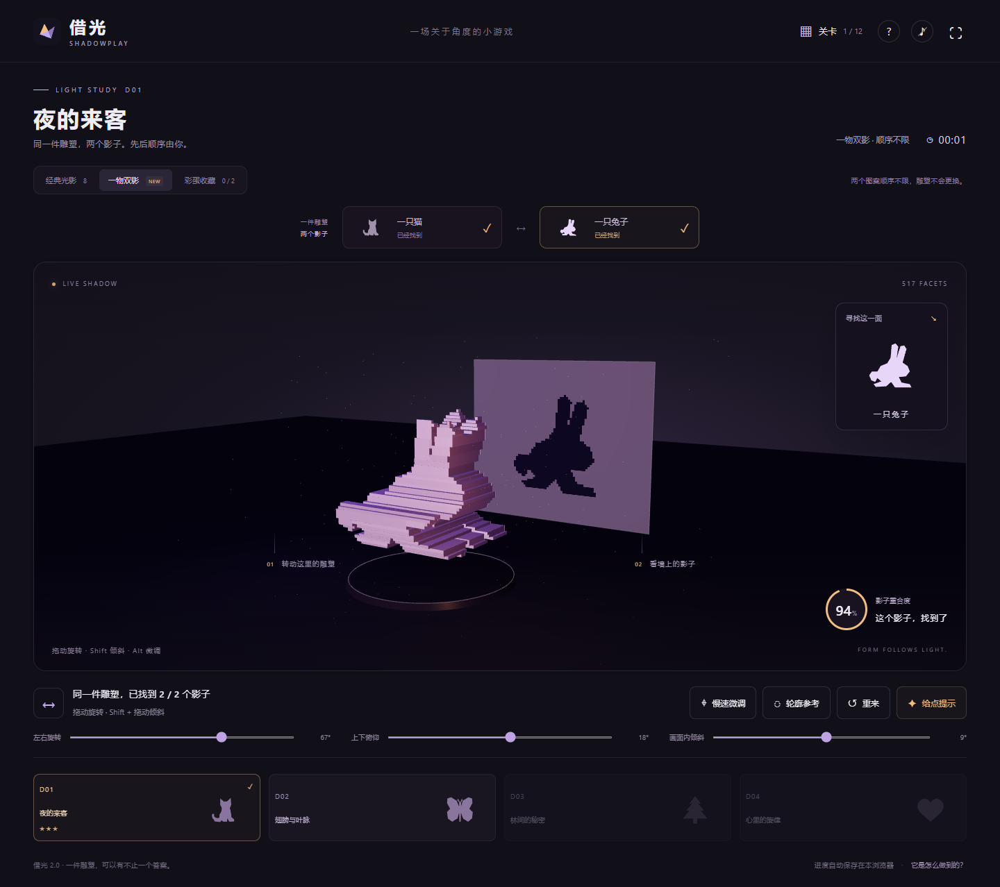

# 借光 · SHADOWPLAY 2.0

转动一件立体雕塑，让它在墙上的影子变成目标图案。

**[打开游戏](https://kznee.github.io/jieguang-shadowplay/)**



## 有什么好玩的

- **经典光影：** 八道关卡，从猫、月亮到纸鹤、灯塔，逐步尝试三个方向的旋转。
- **一物双影：** 四道特殊关卡。同一件真实的三维雕塑，能投出猫与兔、蝴蝶与叶子等两种不同影子；先后顺序不限。第一道双影关可以直接体验。
- **隐藏图案：** 两个未在题目里公布的影子，找到后加入彩蛋收藏。
- **三星重玩：** 通关一星，未用方向提示和未用轮廓参考各加一星；没有时间限制。
- **保存纪念卡：** 可下载通关图片，双影关卡的卡片会保留两个图案。

## 怎么操作

鼠标左右拖动转身，上下拖动俯仰；按住 Shift 拖动可倾斜，按住 Alt 或开启“慢速微调”可精调。键盘方向键旋转，Q/E 倾斜。

手机单指滑动旋转，双指转动倾斜；下方三个滑杆也支持触屏和键盘。投影重合度达到 88%，松开并稳定片刻，即可确认一个目标。双影关卡要找到两面。

## 本机运行

下载仓库 ZIP 并解压，Windows 用户双击 **启动借光.cmd**，保持服务窗口开启即可玩，不需要安装 Node 或联网。

也可以安装 Node 后运行：

```sh
node server.mjs
```

打开 http://127.0.0.1:8894 。游戏是原生 HTML/CSS/JavaScript，无需构建或安装运行依赖。浏览器 ES 模块需要 HTTP 地址，不能直接双击 index.html。需要支持 WebGL 2 的现代浏览器。

## 原理

经典雕塑由前后错开的三角棱柱组成，沿固定方向投影后拼回二维轮廓。双影雕塑使用两幅轮廓沿垂直方向挤出后的体积交集，并合并体素表面来减少面数。转动的是同一件模型，第二个影子来自真实几何投影。

Three.js 渲染三维几何与方向光阴影；判定端把同一几何投影到 128×128 遮罩，比较与目标的交并比（IoU）。任何能投出相似图案的角度都有效，不依赖预设角度距离。双影通关记录取两面确认时重合度的较小值。

本项目由 AI 编程工具辅助开发，游戏本身使用几何计算，不调用收费 AI 接口，也没有训练生成式 AI 模型。

## 保存与隐私

关卡、星级和彩蛋记录仅保存在当前浏览器的 localStorage，不会上传。清理浏览器数据会丢失记录；不同设备和不同网站地址之间不自动同步。没有游戏账号、摄像头、麦克风或统计追踪，音效默认关闭。所有游戏依赖均随仓库提供。

## 验证与代码

- app.js：三维场景、操作、双影流程、收藏与通关卡。
- model.js：关卡轮廓、三角棱柱、双影体素表面、投影与交并比。
- qa/browser.mjs：桌面和手机操作验证，包含双影顺序、隐藏图案、星级、旧进度迁移、下载等 27 项检查。
- qa/geometry-v2.mjs：十二个模型及其第二个投影的几何验证。
- vendor/：本地 Three.js 与其 MIT 许可证。

开发者可以安装测试依赖并另开终端启动游戏后运行测试：

```sh
npm install
npx playwright install chromium
npm test
npm run test:geometry
```

可用 SHADOWPLAY_BASE_URL 指定测试地址。?qa=1 只开启前端自查接口，本游戏没有防作弊比赛或联网排行榜。
